<!--
  Aman Singh · github.com/Aman8401
  All visuals live in /assets as self-contained animated SVGs (fonts embedded).
-->

  
  
  
  
  

 

### Hey, I'm Aman 👋

I'm a **Flutter engineer** at **MPSeDC** (MP State Electronics Development Corporation), working with the **Centre of Excellence & GIS team** in Bhopal.

I build the mobile and web apps behind government services in Madhya Pradesh and India, used by **daily-wage workers, farmers, patwaris, forest officials and citizens**. Most of them work in the field, often with poor internet, in Hindi and English.

**What I bring**

- 📱 **Flutter apps, end to end**, from requirements to production support
- 🗺️ **Maps & GIS**: ArcGIS, Leaflet, OpenStreetMap, KML, rover GPS
- 📴 **Offline-first** sync for field work
- 🏗️ **Clean architecture**: MVVM, Bloc/Cubit, Provider, feature-first
- 🌐 **Bilingual UX** in English & हिंदी

 
 

 

<b>What I do at MPSeDC</b>

 

- Build **scalable, GIS-enabled mobile platforms** for government digital infrastructure
- Own modules across **mapping, offline architecture, API integration** and field-mobility features
- Work across the **full SDLC**, from requirement analysis to production support of live apps
- Deliver for the **Labour, Agriculture (FWAD), Tribal & Forest and Revenue** departments and the **Dept. of Science & Technology (GoI)**

 

  

 

Built for the <b>Government of Madhya Pradesh / Government of India</b> through <b>MPSeDC</b>. The code is government-owned, so these are case studies. <b>Tap a project to read more ↓</b>

<b>01 · Call Karigar</b>: book skilled local workers

 

Connects customers with skilled local workers (**karigars**) such as electricians, plumbers and carpenters. Runs on the [Shramana platform](https://shramana.mp.gov.in).

- **Customer:** find a service, book a worker, track the job, manage saved addresses
- **Karigar:** register skills & categories, handle job requests, manage profile & wallet
- **Features:** phone sign-in · guest mode · job booking & status tracking · wallet & payments · push notifications · location & addresses · full English/हिंदी
- **Built with:** Flutter (Dart) · Bloc/Cubit · Dio · Firebase, organised by feature (auth, home, job, service, profile, wallets, notification, address) with a shared core layer
- **Now:** refactoring for a cleaner, easier-to-maintain codebase

<b>02 · Digital Labour Chowk (DLC – Shree)</b>: live in production

 

Daily-wage workers (masons, painters, plumbers, helpers) gather at one street corner each morning hoping to be hired, and many go home without work. This app puts that **labour chowk on a phone**: employers find workers **by skill and location** and post jobs. Runs on the [Shree portal](https://shree.mp.gov.in).

- Map-based worker search with **Leaflet + OpenStreetMap**
- Job posting and GPS-based worker–employer matching
- Help & support screens for employers
- **v1.0.3 live** on Android, iOS and Web, with separate staging and production builds
- **Built with:** Vue 3 · Vite · Vuetify 3 · Pinia · vue-router · Capacitor 7

<b>03 · SHRAM Worker App</b>: MP Labour Department

 

- Login with **Samagra ID + OTP** and auto-fetched profile
- 5-step employee registration (Proforma-4), nomination (Proforma-7) & certificate
- Attendance check-in/out with **selfie + GPS**, plus office tour / OD
- Wage master, wage register (Proforma-1) & wage slips (Proforma-5)
- Employer linking, notice board, profile, settings & support
- **Built with:** Flutter, strict MVVM (View → ViewModel → Repository → Service → Model), Provider for UI state, Cubit for network state, Dio, flutter_map, Firebase, dark mode, English/हिंदी

<b>04 · YES – Yoga Essential & Suryanamaskar</b>: yoga sessions & QR attendance

 

- **Participants:** register with health info, join instructor-led groups, see upcoming / attended / missed sessions in a calendar
- **Instructors:** create groups, schedule sessions with location & time, generate **QR codes for attendance**, manage participants
- **Admins:** approve instructors, monitor groups & locations, review health reports, track attendance
- Built-in validations and controlled workflows keep the data reliable

<b>05 · Crop Loss</b>: field crop-damage reporting

 

Part of the **MP Government Agri-GIS programme**. Patwaris and field users report crop damage from the spot, and **every report carries a photo and GPS proof**.

- OTP-only login (no passwords) & self-registration by role, district, tehsil, halka and village
- Record events with location, date, loss type, photo & GPS
- Dashboard of counts by district → tehsil → halka → village
- Hindi (default) & English · migrating from legacy **WCF** to a new **Web API**

<b>06 · e-Unnati (Agri-GIS)</b>: Farmer Welfare & Agriculture Dept.

 

Built for the **Farmer Welfare and Agriculture Development Department (FWAD)**, which aims to raise farmers' incomes in Madhya Pradesh and help reach national food self-sufficiency. It supports the department's focus on **advanced farming technology, sustainable resource use and risk management**.

<b>07 · NAKSHA</b>: urban land records, Govt. of India

 

- Multi-state auth & business logic for **29 states + 2 logins**
- ArcGIS workflows: parcel split / merge / delete
- Integrated **external rover hardware** for high-precision GPS
- **Built with:** Flutter · Dart · .NET APIs · PostgreSQL · ArcGIS · AWS S3

<b>08 · MPFRA (Van Adhikar)</b>: forest-rights field survey

 

- Offline-capable data sync & offline GIS workflows
- Forest-zone traversal across range, beat, compartment, sub-division & division boundaries
- Forest boundary APIs, KML routes & geotagged images → PDF
- **Built with:** Flutter · Dart · .NET APIs · SQL Server

Also contributed to the <b>CHAKSHU Portal / NMMSA</b> with the MPSeDC CoE & GIS team.

  

  
  
  

 

  
  

  

 

 

  
  
  
  
  

 

