<!-- ===================== ANIMATED HEADER ===================== -->
<a href="https://github.com/Aman8401">
  
</a>

<p align="center">
  <a href="mailto:pariharaman2001@gmail.com"></a>
  <a href="https://www.linkedin.com/in/amansp"></a>
  <a href="https://www.hackerrank.com/profile/amansp"></a>
  
</p>


## 👋 About Me



I'm a **Flutter developer** at **MPSeDC** (MP State Electronics Development Corporation), working with the **Centre of Excellence & GIS team** in Bhopal.

I build mobile and web apps that real people use every day: **daily-wage workers, farmers, patwaris, forest officials and citizens** across Madhya Pradesh and India.

**What I'm good at**

- 📱 **Flutter apps** from idea to Play Store, Android · iOS · Web
- 🗺️ **Maps & GIS**: ArcGIS, Leaflet, OpenStreetMap, KML, high-precision GPS
- 📴 **Offline-first** apps for field work with weak or no internet
- 🏗️ **Clean architecture**: MVVM, Bloc/Cubit, Provider, feature-first, SOLID
- 🌐 **Bilingual apps**, full English & हिंदी support

📍 Bhopal, India &nbsp;·&nbsp; 🎓 B.Tech IT, UIT-BU &nbsp;·&nbsp; 💬 English, हिंदी

<details>
<summary>👀 <b>Developer version: me, written in Dart</b></summary>
<br/>

```dart
class AmanSingh extends MobileEngineer {
  final role       = 'Associate Engineer (Mobile App)';
  final company    = 'MPSeDC, Govt. of Madhya Pradesh';
  final since      = DateTime(2024, 2);
  final stack      = ['Flutter', 'Dart', 'Bloc/Cubit', 'Vue 3', 'GIS'];
  final languages  = ['English', 'हिंदी'];

  @override
  String get motto => 'Readable before clever. Ship it, then make it better.';
}
```

</details>

<br clear="right"/>

<p align="center">
  
</p>


## 💼 Experience

<table>
<tr>
<td width="90" align="center" valign="top">

</td>
<td valign="top">

### Associate Engineer (Mobile App)
**MP State Electronics Development Corporation Ltd. (MPSeDC)** · Bhopal


- 🧭 Part of the **Centre of Excellence (CoE) & GIS team**, building state and national e-governance apps
- 🗺️ Built **scalable, GIS-enabled mobile platforms** for government digital infrastructure
- 📦 Owned modules for **maps, offline architecture, API integration** and field-mobility features
- 🔁 Worked across the **full SDLC**: requirements → development → release → production support
- 🤝 Delivered for **Labour, Agriculture (FWAD), Tribal & Forest, Revenue** departments and the **Dept. of Science & Technology (GoI)**

</td>
</tr>
</table>


## 🚀 Featured Projects

<p align="center">
  
</p>

<p align="center"><sub>All apps are built for the <b>Government of Madhya Pradesh / Government of India</b> through <b>MPSeDC</b>. The code is government-owned, so these are case studies. <b>Tap a project below to read more.</b></sub></p>

<details>
<summary>🛠️ <b>Call Karigar</b> · book skilled local workers &nbsp;</summary>
<br/>

A mobile app that connects customers with skilled local workers (**karigars**) such as electricians, plumbers and carpenters. Built for the **Government of Madhya Pradesh** through MPSeDC, running on the [Shramana platform](https://shramana.mp.gov.in).

| 👤 Customer | 🔧 Karigar (Worker) |
|---|---|
| Find a service, book a worker | Register skills & service categories |
| Track the job status | Receive & handle job requests |
| Manage saved addresses | Manage profile & wallet |

**Key features:** phone sign-in · guest mode · service categories · job booking & tracking · wallet & payments · push notifications · location & addresses · full English/हिंदी

**Architecture:** feature-first modules (auth, home, job, service, profile, wallets, notification, address) with a shared core layer. **Current focus:** refactoring for a cleaner, easier-to-maintain codebase.

   

</details>

<details>
<summary>🧱 <b>Digital Labour Chowk (DLC – Shree)</b> · labour chowk on your phone &nbsp;</summary>
<br/>

In most towns, daily-wage workers (masons, painters, plumbers, helpers) gather at one street corner every morning hoping to be hired, and many go home without work. This app puts that **labour chowk on people's phones**: employers find workers **by skill and location** and post jobs, and workers get found by employers nearby. Run by the Government of MP through the [Shree portal](https://shree.mp.gov.in).

- 🗺️ Map-based worker search with **Leaflet + OpenStreetMap**
- 📝 Job posting for individuals, contractors and businesses
- 📍 Worker–employer matching using phone GPS
- 💬 Help & support screens for employers
- 📱 **v1.0.3 live in production** on Android, iOS and Web, with separate staging and production builds

Because it's live, every change is checked across the whole codebase, kept dependency-light and shipped with a rollback path.

      

</details>

<details>
<summary>👷 <b>SHRAM Worker App</b> · MP Labour Department &nbsp;</summary>
<br/>

A Flutter app for workers under the **Madhya Pradesh Labour Department**, covering registration, attendance and wages end to end across **18 screens**.

- 🔐 Login with **Samagra ID + OTP**, with auto-fetched profile
- 📝 5-step employee registration (Proforma-4), nomination (Proforma-7) & nomination certificate
- 📸 Attendance check-in/out with **selfie + GPS**, plus office tour / OD
- 💰 Wage master, wage register (Proforma-1) & wage slips (Proforma-5)
- 📢 Employer linking, notice board, profile, settings & support

**Architecture:** strict **MVVM** (View → ViewModel → Repository → Service → Model) · Provider for UI state · Cubit for network state · centralised error handling · offline detection · dark mode · English/हिंदी

     

</details>

<details>
<summary>🧘 <b>YES – Yoga Essential & Suryanamaskar</b> · yoga sessions & QR attendance</summary>
<br/>

A complete digital platform to **promote yoga practice** and manage yoga sessions.

| 🙋 Participants | 🧑‍🏫 Instructors | 🛡️ Admins |
|---|---|---|
| Register with health info | Create & manage yoga groups | Approve & manage instructors |
| Join instructor-led groups | Schedule sessions with location & time | Monitor groups & locations |
| Calendar of upcoming / attended / missed sessions | Generate **QR codes for attendance** | Review health reports & attendance |

Built-in validations and controlled workflows keep the data reliable for every role.

</details>

<details>
<summary>🌾 <b>Crop Loss App</b> · field crop-damage reporting &nbsp;</summary>
<br/>

Part of the **MP Government Agri-GIS programme** (MPSeDC). Patwaris and field users report crop damage straight from the field, and **every report carries a photo and GPS proof**.

- 🔐 OTP-only login (no passwords) & self-registration by role, district, tehsil, halka and village
- 📍 Record crop-loss events with location, date, loss type, photo & GPS coordinates
- 📊 Event list + dashboard of counts by district → tehsil → halka → village
- 🌐 Hindi (default) & English
- 🔄 Migrating from the legacy **WCF service** to a new **Web API**

   

</details>

<details>
<summary>🚜 <b>e-Unnati (Agri-GIS)</b> · Farmer Welfare & Agriculture Dept.</summary>
<br/>

Built for the **Farmer Welfare and Agriculture Development Department (FWAD)** of the Government of Madhya Pradesh, which aims to raise farmers' incomes and help reach national food self-sufficiency. With farmers at the centre, it supports the department's focus on **advanced farming technology, sustainable resource use and risk management**.

</details>

<details>
<summary>🗺️ <b>NAKSHA</b> · urban land records, Govt. of India</summary>
<br/>

Mobile app for **urban land-record digitisation** (Dept. of Science & Technology, GoI).

- 🔑 Multi-state auth & business logic for **29 states + 2 logins**
- ✂️ ArcGIS workflows: parcel split / merge / delete
- 🛰️ Integrated **external rover hardware** for high-precision GPS capture
- 🧩 Scalable Android modules & API integrations

    

</details>

<details>
<summary>🌳 <b>MPFRA (Van Adhikar)</b> · forest-rights field survey</summary>
<br/>

Mobile app & website for the **Tribal & Forest Departments of MP**, built for remote areas.

- 📴 Offline-capable data sync & offline GIS workflows
- 🧭 Forest-zone traversal to capture, view & validate data across range, beat, compartment, sub-division & division
- 🗂️ Forest boundary APIs, KML route support & geotagged images → PDF

    

</details>

<sub>➕ Also contributed to the <b>CHAKSHU Portal / NMMSA</b> with the MPSeDC CoE & GIS team.</sub>


## 🧰 Tech Stack

<p align="center">
  <a href="https://skillicons.dev">
    
  </a>
</p>

| | |
|---|---|
| 📱 **Mobile** |       |
| 🧠 **Architecture** |       |
| 🌐 **Web** |      |
| 🗺️ **GIS & Maps** |      |
| ☁️ **Backend & Cloud** |        |


## 🎓 Education & Achievements

| 🎓 Education | 🏆 Achievements |
|---|---|
| **B.Tech, Information Technology**<br/>UIT-BU (Barkatullah University), Bhopal<br/>2019 – 2023 · **CGPA 7.96** | 🥉 **3rd of 90** in the UIT-BU Techfest coding competition |
| **Class XII**, MP State Board · 2019 · **69.2%** | 🛠️ **Technical Member**, UIT-BU Multimedia & IoT Club (2022–24) |
| **Class X**, MP State Board · 2017 · **91.5%** | ☕ **Java Development** course certificate<br/>🏅 University winner in **Cricket, Kabaddi & 100 m race** |


## 📊 GitHub Activity

<p align="center">
  
  
</p>

<p align="center">
  
</p>

<p align="center">
  <picture>
    <source media="(prefers-color-scheme: dark)" srcset="https://raw.githubusercontent.com/Aman8401/Aman8401/output/github-snake-dark.svg"/>
    <source media="(prefers-color-scheme: light)" srcset="https://raw.githubusercontent.com/Aman8401/Aman8401/output/github-snake.svg"/>
    
  </picture>
</p>


## 🤝 Let's Connect

<p align="center">
  I enjoy building apps that people depend on every day.<br/>
  <b>Open to Flutter / mobile engineering roles and collaborations.</b>
</p>

<p align="center">
  <a href="mailto:pariharaman2001@gmail.com"></a>
  <a href="https://www.linkedin.com/in/amansp"></a>
  <a href="https://www.hackerrank.com/profile/amansp"></a>
</p>

<p align="center">
  
</p>
